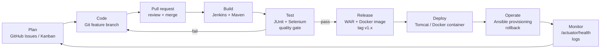

# Task 2 — Agile Planning and DevOps Workflow

## 1. User stories and acceptance criteria

| ID | User story | Acceptance criteria | Priority | Points |
|---|---|---|---|---|
| US-01 | As a **user**, I want to log in so that only authorised staff use the system. | Valid credentials open the dashboard; invalid ones show "Invalid username or password"; logout returns to login page. | Must | 2 |
| US-02 | As a **faculty member**, I want to apply for leave so that I don't need a paper form. | Form has type, start date, end date, reason; new record is saved as **PENDING**; success message shown. | Must | 3 |
| US-03 | As a **faculty member**, I want invalid dates rejected so that records stay correct. | End date before start date shows an error and nothing is saved; reason is mandatory (5–500 chars). | Must | 1 |
| US-04 | As a **faculty member**, I want to see my leave records and their status. | List shows only my records with status badge; detail page shows all fields and HOD comment. | Must | 2 |
| US-05 | As a **faculty member**, I want to edit a pending request. | Edit allowed only while PENDING and only by owner; otherwise an error is shown. | Must | 2 |
| US-06 | As a **faculty member**, I want to cancel a pending request. | Status becomes CANCELLED; cannot be approved afterwards. | Should | 1 |
| US-07 | As the **HOD**, I want to approve or reject requests. | Only HOD sees the buttons; only PENDING can be reviewed; reject needs a comment; reviewer and comment are stored. | Must | 3 |
| US-08 | As a **user**, I want to search and filter records. | Keyword (name/reason/department), status and type filters can be combined. | Must | 2 |
| US-09 | As the **HOD**, I want a summary dashboard. | Shows counts per status, total approved days, upcoming approved leave. | Must | 2 |
| US-10 | As **operations**, I want a health endpoint. | `/actuator/health` returns `{"status":"UP"}` without login. | Must | 1 |
| US-11 | As a **developer**, I want every push built and tested automatically. | Jenkins builds on commit; failing tests stop the pipeline. | Must | 5 |
| US-12 | As **operations**, I want one-command provisioning and rollback. | Ansible playbook configures a clean host; rerun shows `changed=0`; rollback restores previous version. | Must | 5 |

## 2. Product backlog (ordered)

| Rank | Item | Type | Story | Task |
|---|---|---|---|---|
| 1 | Problem definition, scope | Doc | — | T1 |
| 2 | Stories, backlog, DoD, DevOps diagram | Doc | — | T2 |
| 3 | SRS, architecture, local setup | Doc/Setup | — | T3 |
| 4 | GitHub repo, README, templates, branch rules | Setup | — | T4 |
| 5 | Login + apply + view leave | Feature | US-01..04 | T5 |
| 6 | Edit, cancel, approve/reject, search, dashboard | Feature | US-05..10 | T6 |
| 7 | Jenkins CI job | Pipeline | US-11 | T7 |
| 8 | Jenkinsfile + Tomcat deployment | Pipeline | US-11 | T8 |
| 9 | Selenium suite (local) | Test | US-11 | T9 |
| 10 | Selenium quality gate in Jenkins | Test/Pipeline | US-11 | T10 |
| 11 | Dockerfile, container lifecycle | Container | — | T11 |
| 12 | Jenkins → Docker image → registry → deploy | Pipeline | US-11 | T12 |
| 13 | Ansible playbook | Config mgmt | US-12 | T13 |
| 14 | Provisioning, idempotency, health, rollback | Config mgmt | US-12 | T14 |
| 15 | Final release, report, viva | Release | — | T15 |

## 3. Sprint plan (Kanban board, 15 tasks in 5 sprints)

| Sprint | Goal | Tasks | Done when |
|---|---|---|---|
| Sprint 1 | Plan and design | T1, T2, T3 | Docs reviewed; app skeleton runs locally |
| Sprint 2 | Version-controlled MVP | T4, T5, T6 | MVP merged to `main`, tagged `v1.0.0` |
| Sprint 3 | Continuous integration | T7, T8, T9 | Jenkinsfile runs build → package → deploy; Selenium passes locally |
| Sprint 4 | Continuous testing and delivery | T10, T11, T12 | Failed test blocks deploy; image published and container deployed by Jenkins |
| Sprint 5 | Operations and release | T13, T14, T15 | Idempotent provisioning, rollback proven, final report |

Board columns: **Backlog → To Do → In Progress → Review (PR) → Done**. Each task is a GitHub Issue
on a GitHub Project board; a card moves to *Done* only when it meets the Definition of Done.

## 4. Definition of Done

A backlog item is **Done** when:

1. Code is on a feature branch and merged to `develop` through a reviewed pull request.
2. `mvn verify` passes locally: unit tests **and** Selenium UI tests are green.
3. Jenkins pipeline for the merge commit is green (build, tests, package).
4. New behaviour has at least one automated test (unit or Selenium).
5. No secrets in the repository; configuration comes from environment variables.
6. Documentation in `docs/` and the README is updated.
7. The acceptance criteria of the story were checked in the running application.

## 5. DevOps lifecycle

| Stage | Tool | Output |
|---|---|---|
| Plan | GitHub Issues, Projects | Backlog, sprint board |
| Code | Git, GitHub | Commits, branches, PRs |
| Build | Jenkins, Maven | `target/flms.war` |
| Test | JUnit 5, Spring MockMvc, Selenium WebDriver | Surefire + Failsafe reports |
| Release | Maven, Docker, Git tags | Versioned WAR and image |
| Deploy | Jenkins, Tomcat / Docker | Running application |
| Operate | Ansible | Configured host, rollback |
| Monitor | Spring Boot Actuator, `docker logs` | Health status, logs |
