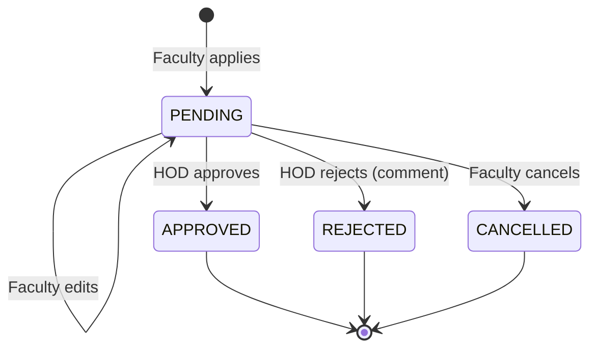
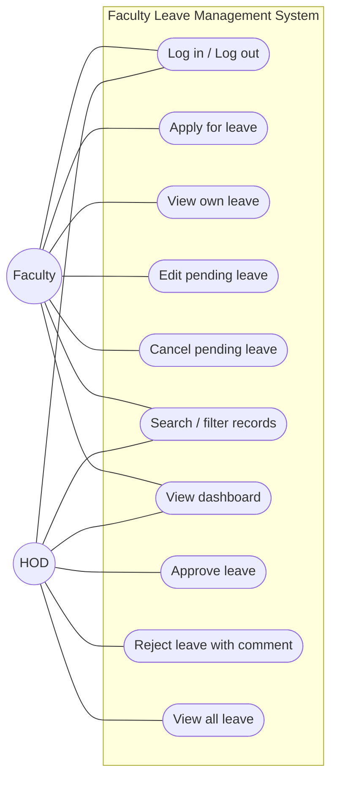
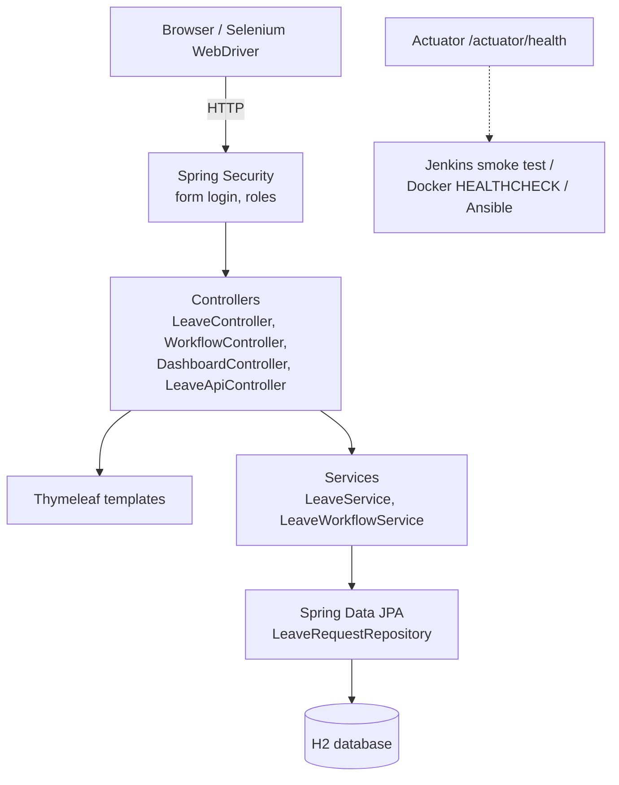

# Task 3 — Requirements, Architecture and Technology Setup

## 1. SRS summary

**Purpose.** A web application where faculty apply for leave and the HOD approves or rejects it,
delivered through an automated build–test–deploy pipeline.

**Functional requirements**

| ID | Requirement |
|---|---|
| FR-1 | The system shall authenticate users and assign role FACULTY or HOD. |
| FR-2 | A faculty member shall create a leave request (type, start date, end date, reason). |
| FR-3 | The system shall reject an end date before the start date and a reason shorter than 5 characters. |
| FR-4 | A faculty member shall view only their own requests; the HOD shall view all requests. |
| FR-5 | A faculty member shall update or cancel a request only while it is PENDING. |
| FR-6 | The HOD shall approve or reject a PENDING request; a rejection requires a comment. |
| FR-7 | Users shall search records by keyword and filter by status and leave type. |
| FR-8 | The dashboard shall show counts per status, approved days and upcoming approved leave. |
| FR-9 | The system shall expose a JSON API for records and summary, and a public health endpoint. |

**Status workflow**



**Non-functional requirements**

| ID | Requirement |
|---|---|
| NFR-1 | Every change is built and tested automatically; no manual deployment. |
| NFR-2 | Pages respond in < 1 s on a lab machine. |
| NFR-3 | Passwords are stored hashed (BCrypt); CSRF protection on all forms. |
| NFR-4 | Configuration (environment, port, DB URL) comes from environment variables. |
| NFR-5 | The application exposes a health check for Docker, Jenkins and Ansible. |

## 2. Use-case diagram



## 3. Architecture



Layered MVC monolith — small enough for one developer, and one WAR that runs both as
`java -jar flms.war` (embedded Tomcat, used in Docker) and inside an external Tomcat (Task 8).

## 4. Data model

**LeaveRequest**

| Field | Type | Notes |
|---|---|---|
| id | Long | Primary key, generated |
| facultyUsername | String | Owner login name |
| facultyName | String | Display name |
| department | String | |
| leaveType | Enum | CASUAL, SICK, EARNED, DUTY, OTHER |
| startDate / endDate | LocalDate | endDate ≥ startDate |
| reason | String(500) | 5–500 chars |
| status | Enum | PENDING, APPROVED, REJECTED, CANCELLED |
| reviewerComment | String(500) | Required on reject |
| reviewedBy | String | HOD username |
| createdAt / updatedAt | LocalDateTime | Audit |

## 5. Endpoint list

| Method | Path | Role | Purpose |
|---|---|---|---|
| GET | `/login` | public | Login page |
| GET | `/dashboard` | any | Summary dashboard |
| GET | `/leaves?q=&status=&type=` | any | List / search (faculty sees own) |
| GET | `/leaves/new` · POST `/leaves` | FACULTY | Apply for leave |
| GET | `/leaves/{id}` | owner / HOD | View details |
| GET | `/leaves/{id}/edit` · POST `/leaves/{id}` | owner | Update pending leave |
| POST | `/leaves/{id}/cancel` | owner | Cancel pending leave |
| POST | `/leaves/{id}/approve` | HOD | Approve |
| POST | `/leaves/{id}/reject` | HOD | Reject with comment |
| GET | `/api/leaves?q=&status=&type=` | any | JSON list |
| GET | `/api/leaves/{id}` | owner / HOD | JSON record |
| GET | `/api/summary` | any | JSON dashboard data |
| GET | `/actuator/health`, `/actuator/info` | public | Health and version |

## 6. Technology stack

| Concern | Choice | Why |
|---|---|---|
| Language / framework | Java 17, Spring Boot 3.5 | Industry standard, Maven-native, embedded Tomcat |
| Build tool | **Maven** | Required by syllabus; Jenkins integration |
| UI | Thymeleaf server-side pages | Simple, Selenium-friendly (stable element IDs) |
| Database | H2 (in-memory or file) | No DB server needed; JPA allows swapping to MySQL later |
| Unit tests | JUnit 5, Spring MockMvc | Fast feedback |
| UI tests | Selenium WebDriver 4 (HtmlUnit headless, or Chrome) | Runs in CI without a display |
| CI/CD | Jenkins (declarative Jenkinsfile) | Pipeline as code |
| Deployment target | Tomcat 10 (WAR) and Docker | Both required by tasks 8 and 11–12 |
| Config management | Ansible | Agentless, YAML, works from WSL |

## 7. Local development setup

Prerequisites: JDK 17+ and Maven 3.8+ (`java -version`, `mvn -v`).

```bash
git clone https://github.com/<your-user>/faculty-leave-devops.git
cd faculty-leave-devops
mvn spring-boot:run                     # http://localhost:8080
# or
mvn -B clean package && java -jar target/flms.war
```

Log in as `faculty1` / `password` (faculty) or `hod` / `password` (HOD).
Run tests: `mvn test` (unit), `mvn verify` (unit + Selenium).
