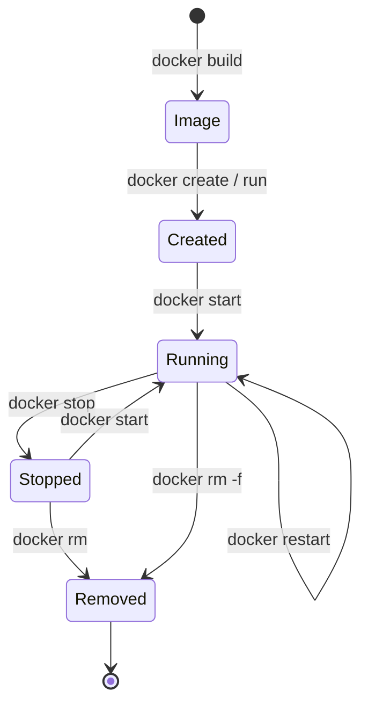

# Task 11 — Docker Image and Container Lifecycle

## 1. Dockerfile

```dockerfile
FROM eclipse-temurin:17-jre-alpine          # small JRE-only base (~ 190 MB final image)
ARG VERSION=dev
LABEL org.opencontainers.image.version="${VERSION}" ...
RUN addgroup -S flms && adduser -S -G flms flms && mkdir -p /app/data && chown -R flms:flms /app
WORKDIR /app
COPY --chown=flms:flms target/flms.war /app/flms.war
USER flms                                    # never run as root
ENV APP_ENV=docker PORT=8080 DB_URL=jdbc:h2:file:/app/data/flms JAVA_OPTS="-XX:MaxRAMPercentage=75"
EXPOSE 8080
VOLUME ["/app/data"]                         # database survives container replacement
HEALTHCHECK ... CMD wget -qO- http://localhost:8080/actuator/health | grep -q '"UP"' || exit 1
ENTRYPOINT ["sh", "-c", "exec java $JAVA_OPTS -jar /app/flms.war"]
```

Design decisions:

| Decision | Reason |
|---|---|
| Copy the tested WAR instead of compiling inside Docker | *Build once, deploy many* — the image contains exactly the artefact that passed the Selenium gate |
| `.dockerignore` excludes everything except `target/flms.war` | Tiny build context, no source or secrets in the image |
| Non-root user, JRE-only Alpine base | Smaller attack surface and image size |
| `HEALTHCHECK` on `/actuator/health` | Docker, Jenkins and Ansible all read the same health status |
| Volume for `/app/data` | Data is not lost when a new version replaces the container |
| Configuration via `ENV` | Same image for dev/staging/prod (`-e APP_ENV=prod`) |

## 2. Container lifecycle — commands

Prerequisite: Docker Desktop with WSL integration enabled (or Docker Engine on Linux).

```bash
# Build
mvn -B package -DskipTests
docker build --build-arg VERSION=1.1.0 -t flms:1.1.0 .
docker tag flms:1.1.0 flms:latest
docker images flms
docker image inspect flms:1.1.0 --format '{{.Config.Labels}} {{.Config.ExposedPorts}} {{.Config.User}}'
docker history flms:1.1.0

# Run (port mapping host 8090 -> container 8080, named volume, env variable)
docker run -d --name flms -p 8090:8080 -e APP_ENV=dev -v flms-data:/app/data flms:1.1.0
docker ps                                    # STATUS shows (health: starting) -> (healthy)
docker port flms
curl http://localhost:8090/actuator/health   # {"status":"UP",...}

# Inspect
docker logs -f flms                          # Ctrl+C to stop following
docker inspect -f '{{.State.Health.Status}}' flms
docker exec -it flms sh                      # look around inside: ls /app, whoami -> flms
docker stats --no-stream flms

# Stop / start / restart
docker stop flms && docker ps -a --filter name=flms     # Exited
docker start flms
docker restart flms

# Remove
docker rm -f flms
docker volume ls                              # flms-data is kept (data survives)
docker volume rm flms-data                    # only when you really want to delete the data
docker rmi flms:1.1.0 flms:latest
```

Or with Compose: `docker compose up -d --build`, `docker compose logs -f`, `docker compose down`.

## 3. Lifecycle states



## 4. Evidence to capture

- `Dockerfile`, output of `docker build`, `docker images`, `docker image inspect`.
- `docker ps` showing `(healthy)` and the `0.0.0.0:8090->8080/tcp` mapping.
- Browser at http://localhost:8090 with the **docker** badge; `docker logs` output.
- The stop / start / restart / rm sequence in a terminal log (`script docs/evidence/task11-docker.log` records a session).
