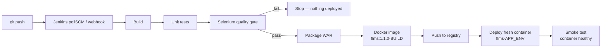

# Task 12 — Jenkins–Docker Continuous Deployment

## 1. End-to-end flow



## 2. Versioning

| Tag | Example | Meaning |
|---|---|---|
| `<pom version>-<build number>` | `localhost:5000/flms:1.1.0-17` | Immutable, traceable to Jenkins build #17 and its commit |
| `latest` | `localhost:5000/flms:latest` | Moves to the newest successful build |

The build's display name in Jenkins shows the same tag (`#17 1.1.0-17 staging`).

## 3. Registry options

**Local registry (no account needed):**

```bash
docker run -d -p 5000:5000 --name registry --restart unless-stopped registry:2
curl http://localhost:5000/v2/flms/tags/list        # after a push: {"name":"flms","tags":["1.1.0-17","latest"]}
```

Pipeline parameters: `REGISTRY=localhost:5000`, `PUSH_IMAGE=true`.

**Docker Hub:** create an access token (Docker Hub → Account settings → Personal access tokens),
add a Jenkins credential *Username with password*, ID **`dockerhub-creds`**, and run with
`REGISTRY=docker.io/<dockerhub-user>`, `PUSH_IMAGE=true`.

## 4. Pipeline stages added (see `Jenkinsfile`)

| Stage | Runs when | Commands |
|---|---|---|
| Docker image | `DEPLOY_TARGET=docker` or `PUSH_IMAGE` | `docker build --build-arg VERSION=$IMAGE_TAG -t $IMAGE:$IMAGE_TAG -t $IMAGE:latest .` |
| Push image | `PUSH_IMAGE=true` | `docker login` (Docker Hub only) → `docker push` both tags |
| Deploy container | `DEPLOY_TARGET=docker` | `docker rm -f flms-$APP_ENV` → `docker run -d ... -e APP_ENV -v flms-$APP_ENV-data:/app/data $IMAGE:$IMAGE_TAG` |
| Smoke test | any deploy | Waits for Docker health status `healthy`, prints `/actuator/info` (shows version + environment) |

Each environment gets its own container and volume (`flms-dev`, `flms-staging`, ...), so
deploying to staging never touches dev.

## 5. Jenkins prerequisites

- Jenkins from `jenkins/docker-compose.yml` already has the Docker CLI and the host Docker socket.
- Native Jenkins: `sudo apt install docker.io && sudo usermod -aG docker jenkins && sudo systemctl restart jenkins`.

## 6. Demonstration script

1. Start the registry (above). Run `flms-pipeline` → *Build with Parameters*:
   `APP_ENV=staging`, `DEPLOY_TARGET=docker`, `REGISTRY=localhost:5000`, `PUSH_IMAGE=true`, `APP_PORT=8090`.
2. Stage View: all stages green. Console shows `docker push ... 1.1.0-N` and `health: healthy`.
3. `curl http://localhost:5000/v2/flms/tags/list` lists the new tag.
4. http://localhost:8090 shows the **staging · v1.1.0** badge.
5. Commit a small change (e.g. text on the dashboard), push → Jenkins builds `1.1.0-(N+1)` and replaces
   the container automatically; data entered earlier is still there (volume).

## 7. Evidence to capture

- Stage View of a full green run; console excerpts for build, push, deploy, smoke test.
- Registry tag list (or Docker Hub repository page) showing versioned tags.
- `docker ps` showing `flms-staging` with the new tag and `(healthy)`.
