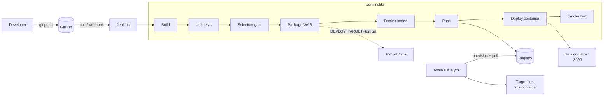

# Task 15 — Final End-to-End Release, Documentation and Viva

**Project:** Automated Testing Pipeline for a Faculty Leave Management System
**Student:** Nidhi Bhawari · Roll No. 23102A0006 · BE Computer Engineering (Sem VII), Div A, Batch 1 · 2026-27

## 1. Abstract

The project delivers a small but complete web application, a Faculty Leave Management System, through
an automated DevOps pipeline. Faculty apply for leave and the HOD approves or rejects it. Every change
goes from a Git commit through a Jenkins build, unit tests and a Selenium browser test suite that acts as a
**quality gate**, into a versioned Docker image deployed automatically. Ansible provisions the server
idempotently and supports health-checked rollback. A deliberately injected UI defect was caught by the
Selenium gate while all unit tests still passed, which shows the value of automated UI testing in CI/CD.

## 2. System summary

| Area | Delivered |
|---|---|
| Application | Spring Boot 3.5 / Java 17, Thymeleaf UI, H2, Spring Security (FACULTY, HOD) |
| Features | Apply, view, edit, cancel, approve/reject with comment, search + filters, dashboard, JSON API, health |
| Tests | 24 unit/MVC tests (JUnit 5, MockMvc) + 14 Selenium WebDriver tests over 5 journeys |
| VCS | GitHub, `main`/`develop`/feature branches, PR merges, real merge conflict resolved, tags `v1.0.0`, `v1.1.0` |
| CI | Jenkins freestyle job (Task 7) and declarative `Jenkinsfile` (Tasks 8, 10, 12) |
| CD | WAR → Tomcat; Docker image `flms:<version>-<build>` → registry → container |
| Config mgmt | Ansible roles `common`, `docker`, `flms`; `site.yml`, `rollback.yml`; ansible-lint *production* profile clean |

## 3. Architecture

Application layers: Browser → Spring Security → Controllers → Services (`LeaveService`,
`LeaveWorkflowService`, `LeaveReportService`) → JPA repository → H2. Details in `03-srs-architecture.md`.

## 4. End-to-end release run (demonstration script)

| # | Step | Command / action | Expected |
|---|---|---|---|
| 1 | Start infrastructure | `cd jenkins && docker compose up -d --build`; `docker run -d -p 5000:5000 --name registry registry:2` | Jenkins :8081, Tomcat :8888, registry :5000 |
| 2 | Change code | e.g. edit dashboard subtitle on `feature/x`, PR → `develop` | PR merged |
| 3 | CI | Jenkins detects commit (pollSCM) | Build starts "by SCM change" |
| 4 | Quality gate | Unit + Selenium stages | 24 + 14 tests green |
| 5 | Release | Docker image `localhost:5000/flms:1.1.0-N` pushed | Tag listed in registry |
| 6 | Deploy | Container `flms-staging` replaced | `health: healthy` |
| 7 | Verify | http://localhost:8090 | Badge **staging · v1.1.0**, change visible |
| 8 | Provision | `ansible-playbook site.yml -e app_version=1.1.0-N` on clean VM | `failed=0`, UP |
| 9 | Idempotency | rerun | `changed=0` |
| 10 | Rollback | `ansible-playbook rollback.yml` | Previous version UP |
| 11 | Release tag | `git checkout main && git merge --no-ff develop && git tag -a v1.1.0` | Tag on GitHub |

Record the run as a screen video (OBS / Xbox Game Bar `Win+Alt+R`) of steps 2–10.

## 5. Test summary

| Suite | Count | Tool | Result |
|---|---|---|---|
| `LeaveServiceTest` | 6 | JUnit + DataJpaTest | Pass |
| `LeaveWorkflowServiceTest` | 7 | JUnit + DataJpaTest | Pass |
| `LeaveReportServiceTest` | 4 | JUnit + fixed Clock | Pass |
| `SecurityAndPagesTest` | 7 | MockMvc + Spring Security Test | Pass |
| Selenium (5 classes) | 14 | WebDriver (HtmlUnit / Chrome) | Pass |
| **Total** | **38** | | **38 / 38** |

Defect-detection demo (Task 10): dashboard counter defect → unit 24/24 pass, Selenium 13/14 → pipeline
stopped before deployment → fixed → 38/38.

## 6. Troubleshooting guide

| Symptom | Cause | Fix |
|---|---|---|
| `docker: command not found` in WSL | Docker Desktop WSL integration off | Docker Desktop → Settings → Resources → WSL integration → enable distro |
| Jenkins: `permission denied ... docker.sock` | Jenkins user not in docker group | Compose file runs Jenkins as root (lab); native: `usermod -aG docker jenkins` + restart |
| Jenkins: `mvn: not found` | Maven not on agent | Use `jenkins/Dockerfile` image, or *Manage Jenkins → Tools* + `tools {}` block |
| Pipeline fails at *Selenium quality gate* | A UI test failed | *Test Result* page + archived `selenium-screenshots/*.html`; run `mvn verify -Dit.test=<Class>` locally |
| `SessionNotCreatedException` with `BROWSER=chrome` | Chrome missing on agent | Install Chrome or use `htmlunit` |
| Tomcat deploy `401` / `403` | Wrong credentials / manager access valve | Check `tomcat-manager` credential and `jenkins/tomcat/*.xml` mounts |
| Tomcat deploy `FAIL - ... context path already exists` | `update=true` missing | Keep `&update=true` in deploy URL |
| Container `unhealthy` | App failed to start | `docker logs flms-<env>`; check `APP_ENV`, port conflicts |
| `port is already allocated` | Port in use | Change `APP_PORT` / `app_port`, or stop the old container |
| `docker push` to `localhost:5000` refused | Registry not running | `docker run -d -p 5000:5000 registry:2` |
| Ansible `Failed to import docker` | python3-docker missing | Installed by `common` role; rerun `site.yml` |
| Ansible health check retries exhausted | Image tag wrong / app crash | `docker ps -a`, `docker logs flms`; verify `-e app_version` exists in registry |
| `rollback.yml`: `previous_version` not found | Only one version ever deployed | Deploy two versions first |
| Git commit fails `gpg failed to sign` | Commit signing enabled, no TTY for passphrase | Run in an interactive terminal or `git config commit.gpgsign false` for this repo |

## 7. Limitations

- Demo users are in-memory; no self-registration, password reset or LDAP/SSO.
- H2 file database: fine for a single instance; not for horizontal scaling.
- No leave-balance rules, holidays, half-days or notifications.
- Single Jenkins controller, polling instead of webhooks (Jenkins is not internet-facing in the lab).
- Rollback restores the application version, not the database schema (schema changes are additive via JPA `update`).
- HtmlUnit doesn't render pixels, so default failure evidence is page HTML; PNG screenshots need Chrome/Firefox.

## 8. Future enhancements

1. MySQL/PostgreSQL with Flyway migrations; users in DB or LDAP.
2. Leave balance and policy engine, holiday calendar, e-mail notifications.
3. GitHub webhook + multibranch pipeline (one pipeline per PR, status checks on GitHub).
4. Selenium Grid / parallel cross-browser runs; visual regression tests.
5. Code quality and security gates: JaCoCo coverage threshold, SonarQube, OWASP Dependency-Check, Trivy image scan.
6. Kubernetes deployment (Helm chart) with blue-green or canary releases; Prometheus + Grafana monitoring.
7. Secrets in HashiCorp Vault or Jenkins credentials only (already no secrets in Git).

## 9. Viva preparation — likely questions

| Question | Short answer |
|---|---|
| What is DevOps? | Practices that join development and operations through automation, fast feedback and shared ownership across the lifecycle plan → code → build → test → release → deploy → operate → monitor. |
| CI vs continuous delivery vs continuous deployment? | CI: every commit built and tested. Delivery: always releasable, deploy is a button. Deployment: every passing commit goes live automatically (our Docker stage). |
| Why Selenium if you have unit tests? | Unit tests check classes; Selenium checks what the user sees. Task 10's defect passed all unit tests but failed Selenium. |
| What is a quality gate? | A pipeline stage whose failure stops promotion. Ours: `mvn verify` (Failsafe) before Package/Deploy. |
| Surefire vs Failsafe? | Surefire runs unit tests in `test` phase; Failsafe runs integration tests in `integration-test`/`verify`, so the app can be started first and the build fails only at `verify`. |
| Why HtmlUnit? | Headless pure-Java browser, no install, ideal for CI agents. Same tests run in Chrome with `-Dbrowser=chrome`. |
| Freestyle job vs pipeline? | Freestyle = UI-configured; Pipeline = `Jenkinsfile` versioned with the code, reviewable, reproducible. |
| How is the environment parameterised? | `APP_ENV` Jenkins parameter → `-Dapp.env` → Maven resource filtering into `application.properties`; runtime env var overrides. |
| Docker image vs container? | Image = read-only template (layers); container = running instance with its own writable layer. |
| Why is your image tagged `1.1.0-17`? | Semantic version + build number → immutable, traceable to a Jenkins build and commit; `latest` is just a moving pointer. |
| What does HEALTHCHECK do? | Docker periodically runs the command; status becomes healthy/unhealthy. Jenkins smoke test and `docker ps` use it. |
| What is idempotency? | Applying the same configuration again changes nothing (`changed=0`). Achieved with declarative modules. |
| Ansible vs Puppet? | Ansible: agentless, push, YAML, SSH. Puppet: agent on each node, pull model, own DSL, master server. |
| How does rollback work? | Ansible records `current_version`/`previous_version`; `rollback.yml` redeploys the previous tag and re-runs the health check. |
| How did you resolve the merge conflict? | Two branches edited the same README lines and `LeaveController` constructor; kept both changes, re-ran tests, committed the merge. |
| How are passwords stored? | BCrypt via Spring's `DelegatingPasswordEncoder`; CSRF tokens on all forms. |

## 10. Deliverables index

| Deliverable | Location |
|---|---|
| Final repository | GitHub `faculty-leave-devops` (`main`, tag `v1.1.0`) |
| Documentation per task | `docs/01` … `docs/15` |
| Evidence files | `docs/evidence/` |
| Screenshot checklist | `docs/EVIDENCE-CHECKLIST.md` |
| Presentation outline | Section 11 below |

## 11. Presentation outline (10–12 slides)

1. Title — project, name, roll number, guide
2. Problem and objectives (Task 1)
3. Agile plan and DevOps lifecycle diagram (Task 2)
4. Architecture and data model (Task 3)
5. Git workflow — branches, PRs, conflict, tags (Tasks 4–6)
6. Jenkins CI and pipeline stages (Tasks 7–8)
7. Selenium suite and quality gate; defect demo (Tasks 9–10)
8. Docker image and CD to container (Tasks 11–12)
9. Ansible provisioning, idempotency, rollback (Tasks 13–14)
10. Live demo
11. Results, limitations, future work
12. Q&A
